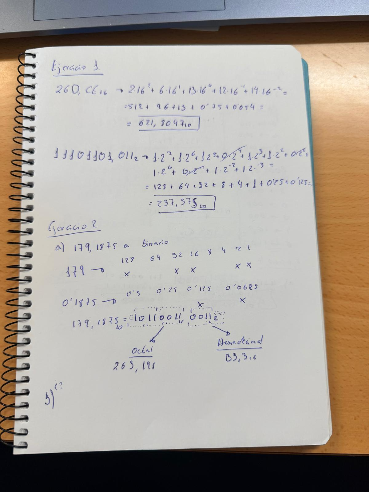
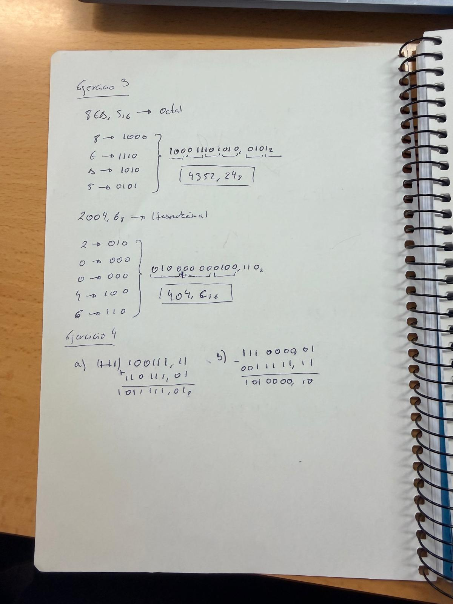
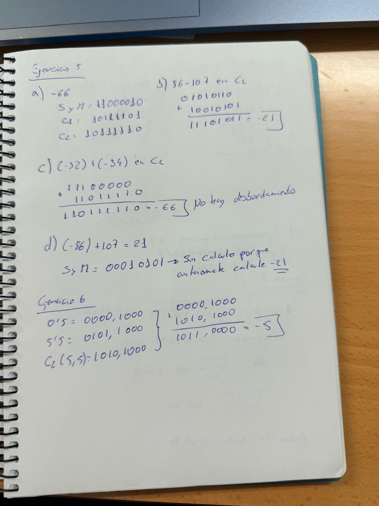
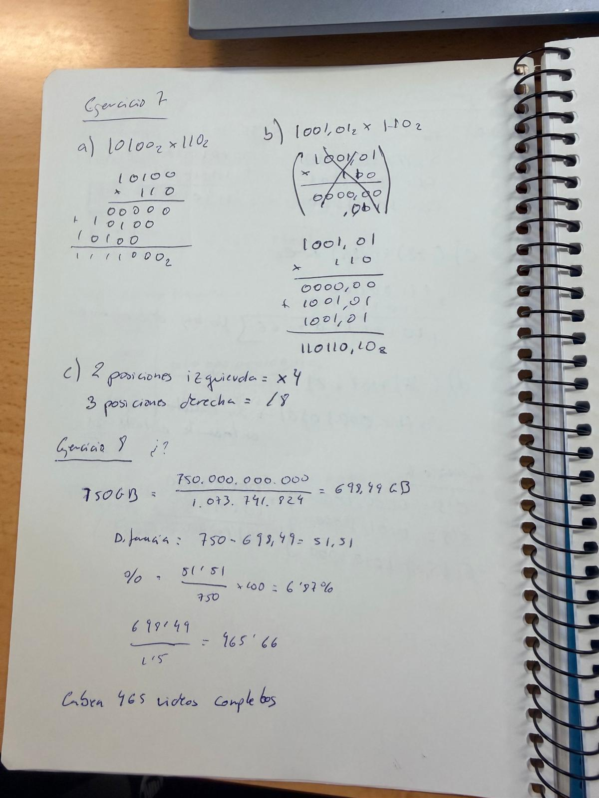
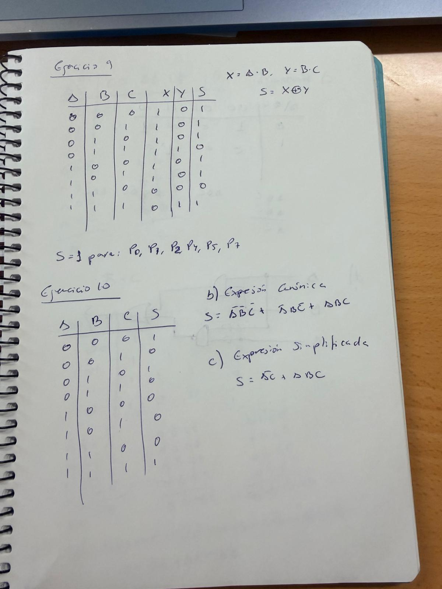
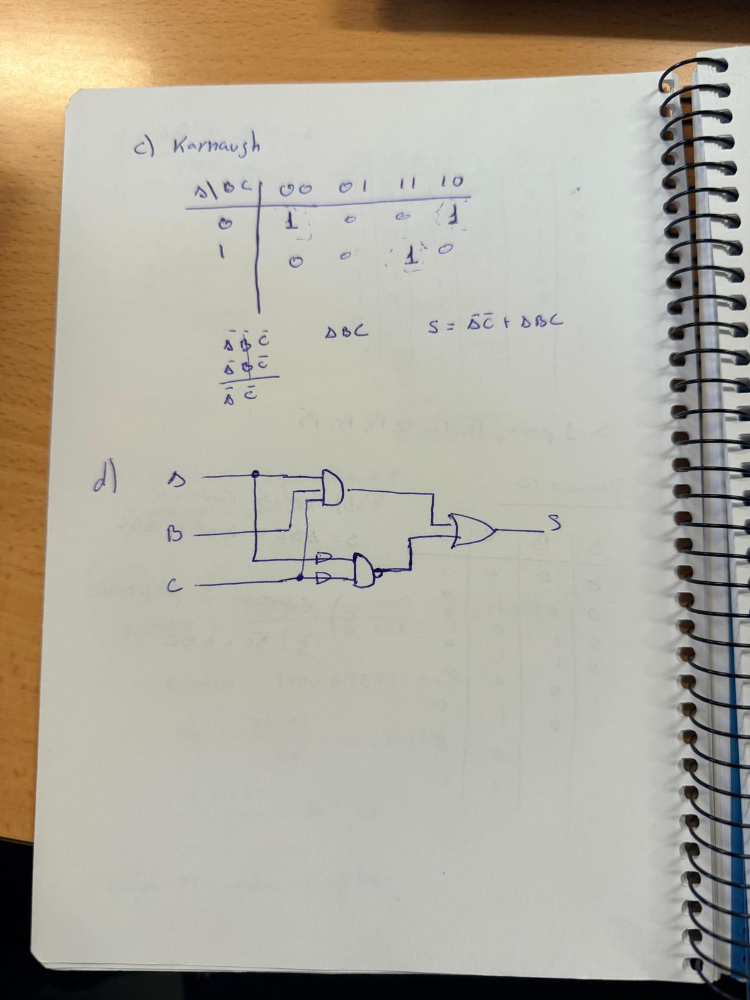

# Relacion de Ejercicios de Binario y de Puertas Logicas

>@autor_: Pablo HR

## Relacion 11-

### Ejercicio 1
26D,CE(16 = 621,8047(10
11101101,011(2 = 237,375(10

###Ejercico 2
179,1875(10 = 10110011,0011(2 = 263,198(8 = B3,3(16

###Ejercicio 3
8EA,5(16 = 4352,24(8
2004,8(8 = 404,C(16

###Ejercicio 4
a) 1011111,01(2
b) 1010000,10(2

###Ejercicio 5 
a) SyM = 11000010(2; C1 = 10111101(2; C2 = 10111110(2
b) 11101011(2 
c)10111110(2 No hay desbordamiento porque se encuentra dentro del rango

###Ejercicio 6
1011,0000(2 = -5(10

###Ejercicio 7
a) 1111000(2
b) 110110,10(2
c) 2 posiciones a la izquierda se multiplica por 4, y, 3 posiciones a la derecha se divide entre 8

###Ejercicio 8
Caben 465 videos completos

###Ejercicio 9
A|B|C|X|Y|S
0|0|0|1|0|1
0|0|1|1|0|1
0|1|0|1|0|1
0|1|1|1|1|0
1|0|0|1|0|1
1|0|1|1|0|1
1|1|0|0|0|0
1|1|1|0|1|1

S=1 EN P0,P1,P2,P4,P5,P7

###Ejercicio 10
A|B|C|S
0|0|0|1
0|0|1|0
0|1|0|1
0|1|1|0
1|0|0|0
1|0|1|0
1|1|0|0
1|1|1|1

b)S=¬A¬B¬C + ¬AB¬C + ABC
c)S=¬AC + ABC

- Apartado a solucion 
 
### 5-October-2026

